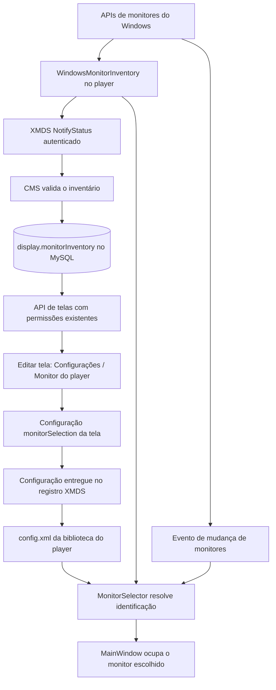

# Arquitetura da seleção de monitor Windows

Este documento descreve o fluxo acrescentado nos forks do CMS e do player Windows. Os demais fluxos do Xibo seguem a arquitetura original do projeto.

O player coleta os monitores no ciclo normal de relatório, sem novo endpoint nem serviço. O CMS guarda somente os campos validados e a hora UTC de recebimento. A lista do dashboard é a última conhecida, e pode estar desatualizada enquanto o computador estiver offline ou até seu próximo relatório.

A configuração e o inventário são dados diferentes: desconectar um monitor não apaga a seleção. O player resolve a identificação novamente ao iniciar e nos eventos de tela do Windows, usando temporariamente o principal quando o escolhido estiver ausente. Uma alteração feita pelo CMS exige recebimento e reinício do player.

A migração `20261109150000_add_windows_monitor_inventory.php` deve ser aplicada antes de servir o CMS modificado. O contrato e suas limitações estão registrados no [ADR 0002](adr/0002-windows-monitor-inventory.md).
